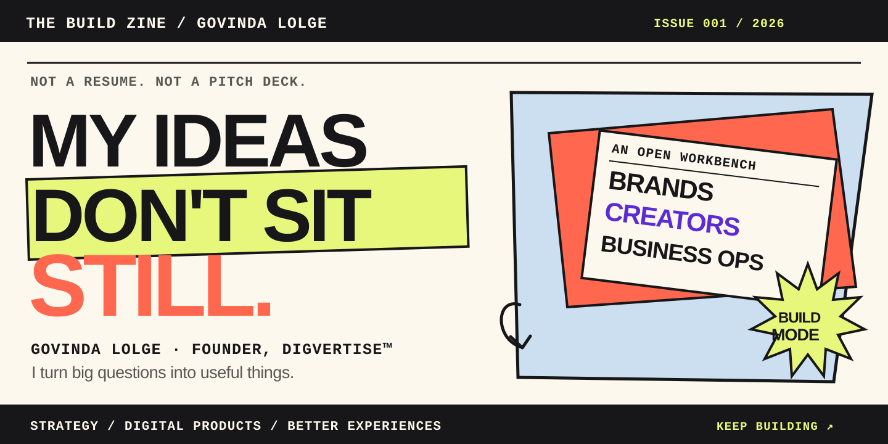
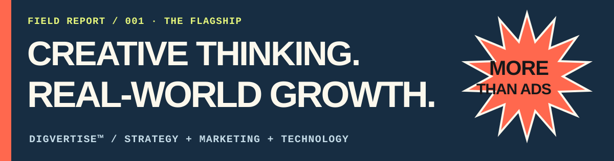
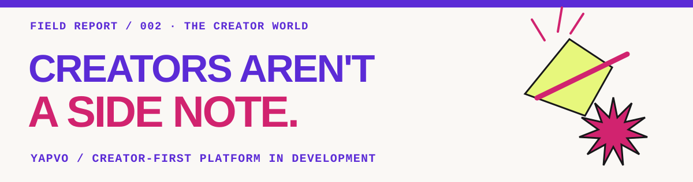
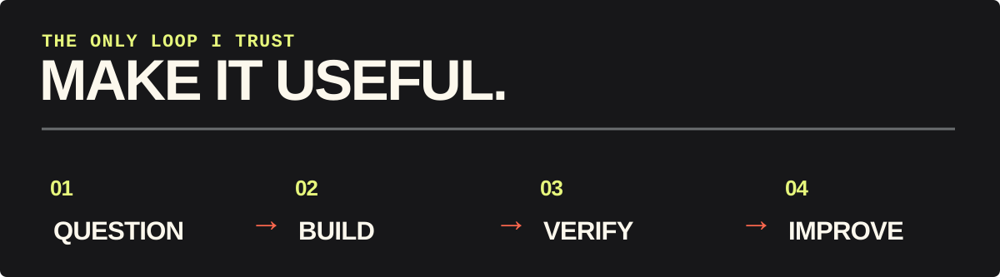

<!-- THE BUILD ZINE · creative founder profile concept V3 -->

<picture>
  <source media="(max-width: 650px)" srcset="./assets/build-zine/cover-mobile.svg">
  
</picture>

 

### GOVINDA LOLGE / FOUNDER, DIGVERTISE™

*Part strategy. Part curiosity. Fully committed to building things that matter.*

## `001 / Things that made it off the drawing board`

**Three different worlds. One founder's desk.** These are ventures and products I am building, not a list of code repositories.

**[Digvertise™ ↗](https://digvertise.com/)** — My flagship brand, bringing together growth strategy, digital marketing, creative execution and technology.

**[YAPVO ↗](https://yapvo.com/)** — A creator-first platform being developed around social connection, professional opportunities and automation.  
**[Explore website](https://yapvo.com/)** · **[Android app on Google Play](https://play.google.com/store/apps/details?id=in.vaao.yapvo)**

**[VAaO™ ↗](https://vaao.in/)** — Digvertise's technology engine. A modular Business Operating System is in development, designed to make business operations more connected and practical.

Product descriptions reflect direction and ongoing development. They don't imply that all planned capabilities are available today.

## `002 / My kind of workflow`

  

I'm interested in **the messy middle**: figuring out what a product should do, why it matters, how people will experience it, and whether the final thing actually works.

I care about good design, privacy, useful automation and execution that stands up to real-world use.

## `003 / The person behind the projects`

I'm **Govinda Lolge**. I founded **Digvertise™**, and I'm building **YAPVO** and **VAaO™** as distinct parts of a bigger journey in digital products and business technology.

I don't think everything needs an AI badge, a complicated dashboard, or ten new features. I think it needs **a reason to exist**.

> Less performance. More meaningful progress.

## `004 / Got an interesting problem?`

**Let's exchange ideas.**

[**Email**](mailto:govindalolge@digvertise.com) · [**LinkedIn**](https://www.linkedin.com/in/govinda-lolge/) · [**Instagram**](https://www.instagram.com/govindalolge/)

[**Digvertise™**](https://digvertise.com/) · [**YAPVO**](https://yapvo.com/) · [**VAaO™**](https://vaao.in/)

Govinda Lolge · Maharashtra, India · Always a work in progress.

