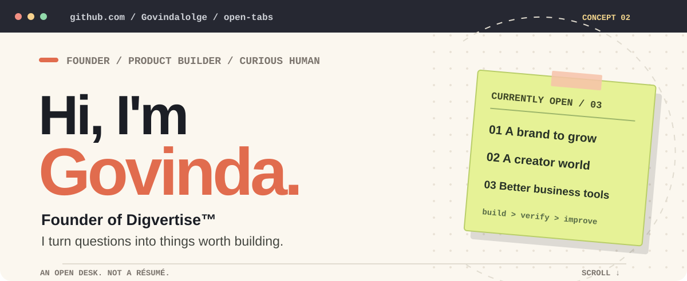
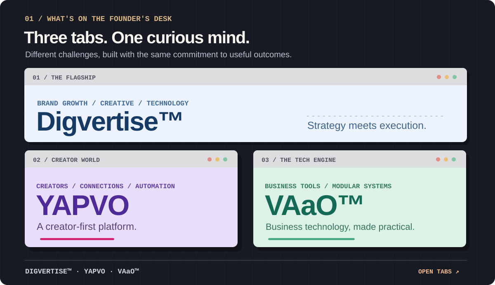
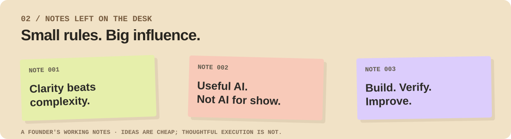

<!-- OPEN TABS / FOUNDER PROFILE V2 · original GitHub-compatible SVG design -->

<picture>
  <source media="(prefers-color-scheme: dark)" srcset="./assets/open-tabs/hero-dark.svg">
  <source media="(prefers-color-scheme: light)" srcset="./assets/open-tabs/hero-light.svg">
  
</picture>

### Govinda Lolge · Founder of Digvertise™ · Product Builder

*Building brands, creator technology, and useful business products.*

  
  
  

## `01 / What's on my desk`

  

**Open a tab:**

| Venture | Explore |
| :-- | :-- |
| **Digvertise™** · Growth, creative and technology | [digvertise.com ↗](https://digvertise.com/) |
| **YAPVO** · Creator-first platform | [yapvo.com ↗](https://yapvo.com/) · [Android on Google Play ↗](https://play.google.com/store/apps/details?id=in.vaao.yapvo) |
| **VAaO™** · Digvertise's technology engine and modular Business OS | [vaao.in ↗](https://vaao.in/) |

YAPVO and the VAaO™ Business OS are ongoing product builds. The cards describe direction, not a claim that every planned feature is live.

## `02 / Notes to self`

  

## `03 / More human than a tech stack`

I'm **Govinda Lolge**, the founder of **Digvertise™**. I like turning real-world problems into products and experiences that are clear, considered, and genuinely useful.

My work connects business strategy, product thinking, AI-assisted development, creator technology, and practical operations. I care as much about **what to build and why** as I do about getting it delivered well.

> The most interesting part isn't having an idea. It's figuring out how to make it useful.

## `04 / Outside the tabs`

For product conversations, thoughtful collaborations, and business inquiries:

**[govindalolge@digvertise.com](mailto:govindalolge@digvertise.com)**

[**LinkedIn**](https://www.linkedin.com/in/govinda-lolge/) · [**Instagram**](https://www.instagram.com/govindalolge/) · [**Digvertise™**](https://digvertise.com/) · [**YAPVO**](https://yapvo.com/) · [**VAaO™**](https://vaao.in/)

Founder mode: build → verify → improve. &nbsp; · &nbsp; Maharashtra, India.

