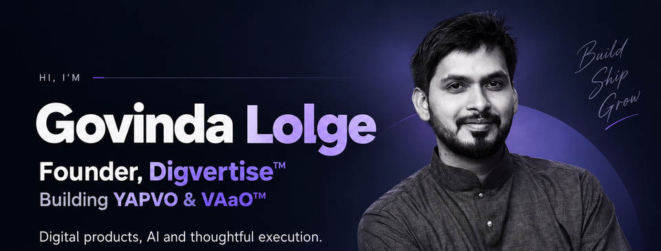
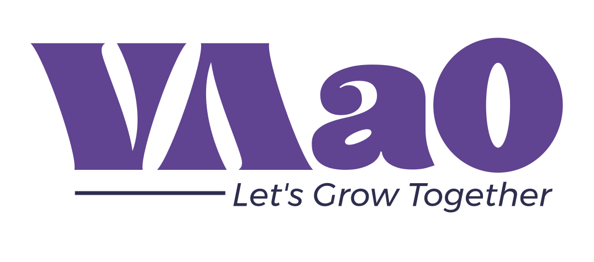

<!-- GITHUB FOUNDER PROFILE V3 · professional editorial direction -->

 

**FOUNDER · ENTREPRENEUR · PRODUCT BUILDER**

Building thoughtful digital products and technology-led businesses.

## The founder behind the products

I'm **Govinda Lolge**, Founder of **Digvertise™**.

My work brings together **business strategy, technology, product thinking and digital experiences**. I focus on understanding real challenges, shaping practical solutions and making sure that what gets built actually works for the people using it.

## Ventures & products

<table>
<tr>
<td width="33%" align="center" valign="top">
  
  <h3>Digvertise™</h3>
  
<strong>Digital growth & technology</strong>

  
Strategy, branding, marketing and practical digital solutions for organizations.

  <a href="https://digvertise.com/">Visit website ↗</a>
</td>
<td width="33%" align="center" valign="top">
  
  <h3>YAPVO</h3>
  
<strong>Creator-first technology</strong>

  
A developing creator platform combining professional connections and creator-oriented automation.

  <a href="https://yapvo.com/">Website ↗</a> · <a href="https://play.google.com/store/apps/details?id=in.vaao.yapvo">Android ↗</a>
</td>
<td width="34%" align="center" valign="top">
  
  <h3>VAaO™</h3>
  
<strong>Business OS & technology</strong>

  
Developing a modular Business Operating System to simplify connected business operations.

  <a href="https://vaao.in/">Visit website ↗</a>
</td>
</tr>
</table>

Product development is ongoing. Future capabilities are not represented here as already launched.

## How I approach building

**Understand the problem → Design for people → Build with purpose → Verify the outcome.**

I believe great digital products are not defined by the number of features they contain, but by the problems they solve, the trust they earn and the experiences they deliver.

**Current focus:** product strategy, AI-assisted workflows, automation, creator technology and modular business software.

## Let's connect

For collaborations, business conversations or thoughtful product discussions:

**[govindalolge@digvertise.com](mailto:govindalolge@digvertise.com)**

[LinkedIn](https://www.linkedin.com/in/govinda-lolge/) · [Instagram](https://www.instagram.com/govindalolge/) · [Digvertise™](https://digvertise.com/) · [YAPVO](https://yapvo.com/) · [VAaO™](https://vaao.in/)

---

Govinda Lolge · Founder, Digvertise™ · Maharashtra, India
