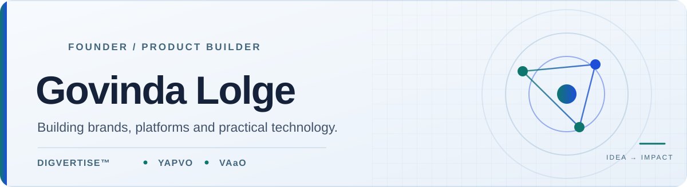

<div align="center">

<picture>
  <source media="(prefers-color-scheme: dark)" srcset="./assets/founder-banner-dark.svg">
  <source media="(prefers-color-scheme: light)" srcset="./assets/founder-banner-light.svg">
  
</picture>

<br>

### Founder of Digvertise™ · Building YAPVO & VAaO™

**From business challenges to thoughtful digital products.**

<a href="https://digvertise.com/"></a>
<a href="https://www.linkedin.com/in/govinda-lolge/"></a>
<a href="https://www.instagram.com/govindalolge/"></a>
<a href="mailto:govindalolge@digvertise.com"></a>

<br><br>

<a href="https://yapvo.com/"></a>
<a href="https://vaao.in/"></a>
<a href="https://play.google.com/store/apps/details?id=in.vaao.yapvo"></a>

</div>

## The founder's desk

I'm **Govinda Lolge**, the founder of **Digvertise™**.

I work across **business strategy, product direction, digital experiences, and technology-led execution**, with a simple goal: build solutions that make a meaningful difference to how people and businesses work.

My interests span creator technology, business operating systems, AI-assisted workflows, and the connection between good strategy and reliable execution.

## Ventures & products

<table>
<tr>
<td width="33%" valign="top">

### 🌐 [Digvertise™](https://digvertise.com/)

**Digital growth & technology**

The flagship brand focused on brand growth, marketing strategy, creative execution, and technology-driven solutions.

</td>
<td width="33%" valign="top">

### ✨ [YAPVO](https://yapvo.com/)

**Creator-first platform**

Building a platform that brings together creator experiences, professional connections, and automation.

**Explore:** [Website](https://yapvo.com/) · [Android app on Google Play](https://play.google.com/store/apps/details?id=in.vaao.yapvo)

<sub>Product development in progress.</sub>

</td>
<td width="34%" valign="top">

### ⚙️ [VAaO™](https://vaao.in/)

**Business technology & operations**

The technology engine of Digvertise, with a modular Business Operating System taking shape.

<sub>Product development in progress.</sub>

</td>
</tr>
</table>

## What drives my work

| Direction | What it means |
|:--|:--|
| **Product thinking** | Solve real problems before adding features. |
| **Thoughtful experiences** | Make complex systems feel clear, useful, and intuitive. |
| **AI & automation** | Use intelligent workflows to reduce repetitive work. |
| **Trust & execution** | Value reliability, privacy, and outcomes that can be verified. |
| **Long-term building** | Create systems that can evolve as users and businesses grow. |

## Current focus

```text
STRATEGY  →  PRODUCT  →  EXPERIENCE  →  EXECUTION

DIGVERTISE   Brand growth & digital solutions
YAPVO        Creator-first platform
VAaO™         Modular business technology
```

<div align="center">

### Let's connect

For product conversations, collaborations, or business inquiries:

**[govindalolge@digvertise.com](mailto:govindalolge@digvertise.com)**

[Website](https://digvertise.com/) · [LinkedIn](https://www.linkedin.com/in/govinda-lolge/) · [Instagram](https://www.instagram.com/govindalolge/)

<sub>Building with purpose. Improving through execution.</sub>

</div>
